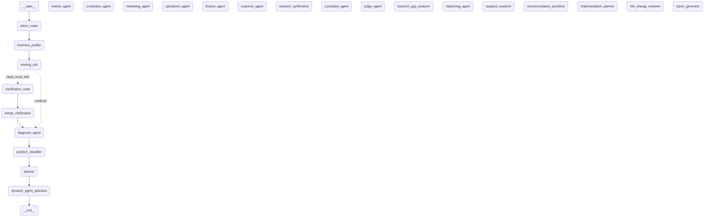

# BizGPT — Multi-Agent AI Business Consultant

BizGPT is a multi-agent "business consultant" built with **LangGraph** and local LLMs served by **Ollama**. Describe your business and a problem; a graph of specialised agents profiles the business, asks clarifying questions, researches market, competitor, customer, finance, marketing and operations angles, then produces a prioritised, reviewed action plan and report.

## Features

- **Intent routing** — casual chat goes to a chat agent; consulting requests enter the full pipeline.
- **Human-in-the-loop clarification** — the graph pauses (LangGraph `interrupt`) to ask for missing information, then resumes.
- **Dynamic agent selection** — only the domain agents relevant to the problem run.
- **Research → synthesis → gap analysis loop** — targeted research fills gaps before diagnosis.
- **Judge & replanning** — a judge agent reviews output quality and can trigger replanning.
- **Final report** — prioritised recommendations, implementation plan, and risk/change review.
- **Streamlit UI** with live workflow events.

## Architecture



```
agents/    Domain specialists (market, competitor, customer, finance, marketing, operations)
nodes/     Pipeline steps (intent router, profiler, clarification, planner, diagnosis, judge, report, ...)
graph/     State definition (state.py) and graph wiring (graph.py)
prompts/   One prompt template per agent/node (.txt)
app/       Streamlit frontend
main.py    CLI entry point
```

## Setup

Requirements: Python 3.10+ and [Ollama](https://ollama.com) running locally.

```bash
git clone https://github.com/AbdulWasayTabba/BusinessConsultantBot.git
cd BusinessConsultantBot
python -m venv .venv
source .venv/bin/activate   # Windows: .venv\Scripts\activate
pip install -r requirements.txt
ollama pull phi3:mini
cp .env.example .env        # then fill in values as needed
```

## Usage

Streamlit UI:

```bash
streamlit run app/app.py
```

Command line:

```bash
python main.py
```

## Environment variables

See `.env.example`. All are optional.

| Variable | Purpose |
| --- | --- |
| `OLLAMA_HOST` | Ollama server URL (default `http://localhost:11434`) |
| `LANGCHAIN_API_KEY` | LangSmith API key for tracing |
| `LANGCHAIN_TRACING_V2` | Set `true` to enable LangSmith tracing |
| `LANGCHAIN_PROJECT` | LangSmith project name |

Never commit your `.env` file.

## Roadmap

Planned work (config module, logging, tests, CI, FastAPI, Docker, deployment) is tracked in [ROADMAP.md](ROADMAP.md).
